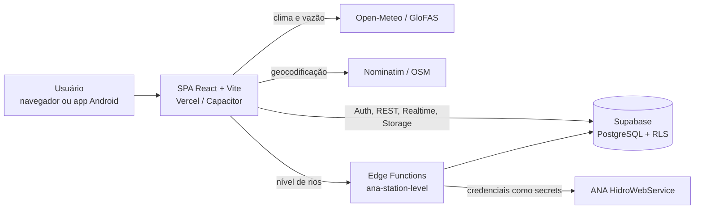

# Arquitetura do SustentaSampa

## Visão geral

Aplicação de página única (SPA) em React 19 + Vite, sem servidor próprio. Toda a persistência, autenticação e tempo real ficam no Supabase; os dados externos (clima, rios, geocodificação) são consultados por APIs abertas. O mesmo código roda no navegador (Vercel) e como aplicativo Android (Capacitor).

## Camadas e responsabilidades

| Camada | Onde fica | Responsabilidade |
| --- | --- | --- |
| Interface | `src/routes`, `src/components` | Telas (mapa, rios, chat, probabilidade, relatório) e navegação |
| Regras de negócio | `src/lib` | Funções puras e testadas: risco, agrupamento, probabilidade, limite de reportes, alerta de proximidade, relatório |
| Acesso a dados | `src/integrations/supabase` | Cliente e tipos do banco |
| Backend | `supabase/` | Schema, políticas RLS, gatilhos e Edge Functions |

## Banco de dados (Supabase / PostgreSQL)

| Tabela | Finalidade | Campos principais |
| --- | --- | --- |
| `profiles` | Perfil do usuário e pontuação | `id` (= `auth.users.id`), `display_name`, `points`, `reports_count`, `avatar_color`, `is_admin` |
| `flood_reports` | Reportes de alagamento | `user_id`, `lat`, `lng`, `cep`, `trafficability`, `water_level`, `weight`, `photo_url`, `hidden_at`, `created_at` |
| `chat_messages` | Mensagens do chat | `user_id`, `display_name`, `content`, `created_at` |
| `river_stations` | Estações de monitoramento de rios (ANA) | `codigo_estacao`, `nome`, `rio_bacia`, `municipio`, `uf`, `lat`, `lng` |

**Regras aplicadas no banco (gatilhos):**
- ao gravar um reporte: soma 10 pontos e 1 reporte ao autor (`0001`);
- antes de gravar: recusa o 4º reporte na mesma hora (`0007`, limite de 3 por hora);
- ao ocultar um reporte: remove os 10 pontos do autor, e os devolve se voltar a ficar visível (`0008`).

As migrations em `supabase/migrations/` (0001 a 0008) são aplicadas em ordem no SQL Editor do Supabase.

## Segurança

- **RLS em todas as tabelas:** só usuários autenticados leem; cada usuário só insere reportes e mensagens em seu próprio nome.
- **Ações administrativas** (ocultar reporte, excluir mensagem) são permitidas apenas a administradores, aplicado no banco (RNF02) e não só na interface.
- **Credenciais da ANA** ficam como *secrets* das Edge Functions e nunca chegam ao cliente (RNF09).
- **Segredos fora do Git:** `.env` está no `.gitignore`; só a chave pública (publishable) do Supabase é usada no cliente.
- **Fotos** são comprimidas no navegador antes do envio (RNF06) e guardadas no bucket público `flood-reports`.

## Decisões técnicas

| Decisão | Motivo |
| --- | --- |
| SPA com Supabase, sem backend próprio | Menos infraestrutura para manter (RNF12) e tempo real nativo para o chat |
| Regras de negócio em funções puras (`src/lib`) | Testáveis sem navegador; reaproveitadas no mapa, no alerta e no relatório |
| Limite de reportes e pontos por gatilho no banco | A regra vale mesmo que alguém chame a API diretamente, sem passar pela interface |
| Probabilidade de alagamento baseada em dados meteorológicos, sem usar os reportes | Evita manipulação do indicador por reportes falsos |
| Mapa de calor + agrupamento por CEP/grade | Mostra concentração de reportes sem poluir o mapa |
| Alerta de proximidade só com o app aberto | Evita enviar a localização de todos os usuários ao servidor (privacidade) |

## Qualidade e entrega

- **Testes:** Vitest cobre as regras em `src/lib` (`*.test.ts`).
- **CI:** GitHub Actions (`.github/workflows/ci.yml`) roda lint, testes, build e checagem de tipos em cada push e pull request.
- **Fluxo de Git:** um branch por tarefa, pull request, CI verde e merge na `main`; proteção de branch exige PR e checagem aprovada.
- **Deploy:** a Vercel publica a `main` e gera um preview para cada pull request; `vercel.json` reescreve as rotas da SPA para `index.html`.
