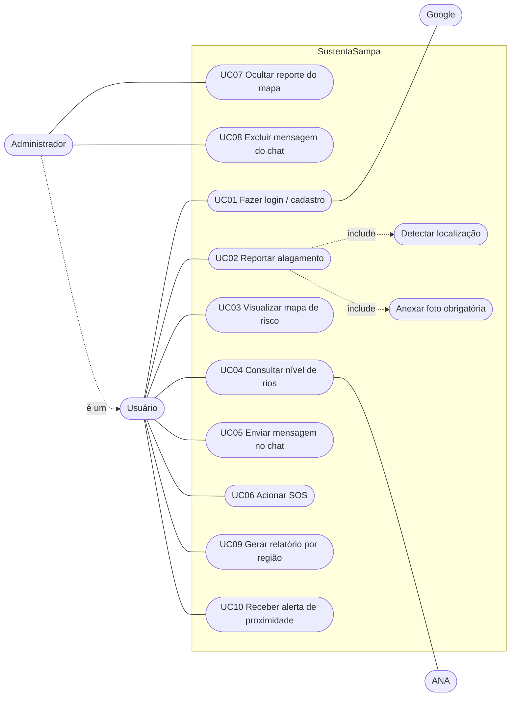
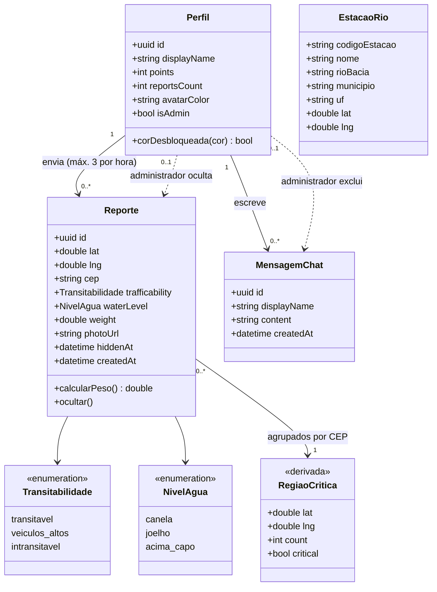
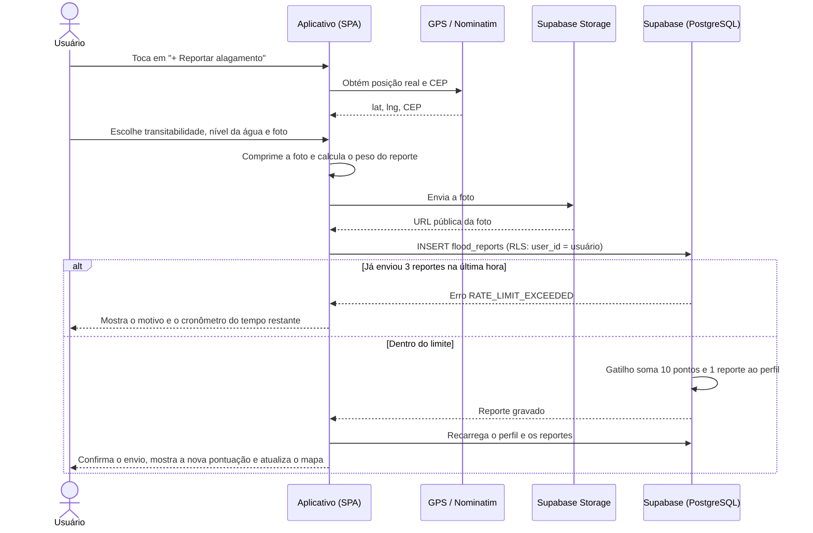
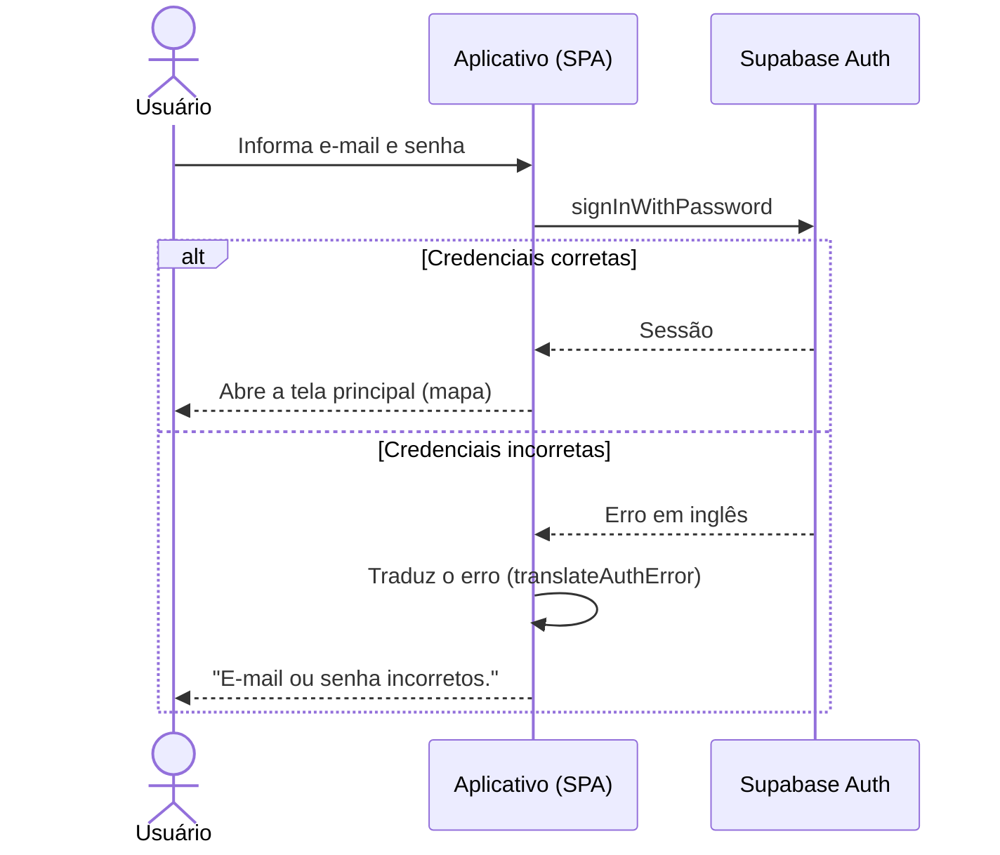
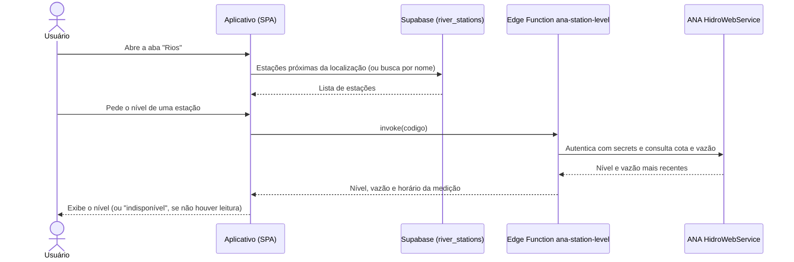
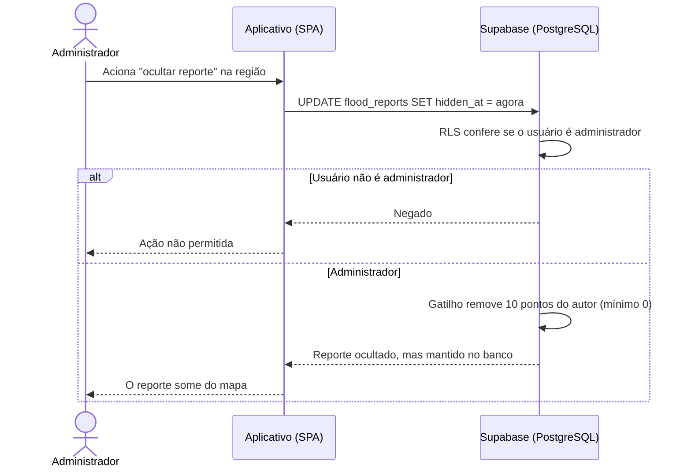
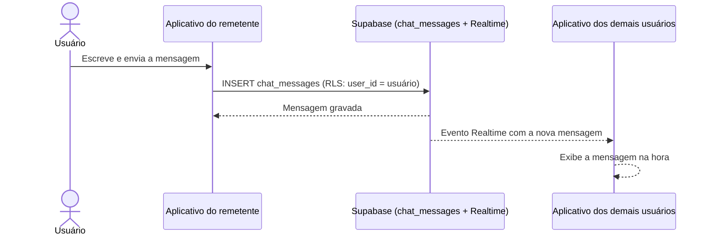

# Modelagem do SustentaSampa

Modelagem dos requisitos funcionais priorizados e já implementados: casos de uso, diagrama de classes e diagramas de sequência. Os diagramas abaixo usam Mermaid e são exibidos diretamente no GitHub.

## 1. Casos de uso

### Atores

| Ator | Descrição |
| --- | --- |
| Usuário | Morador que usa o aplicativo (web ou Android) |
| Administrador | Usuário com permissão de moderação |
| Google | Sistema externo usado no login social |
| ANA | Sistema externo com os níveis dos rios |

### Diagrama de casos de uso

### Casos de uso e requisitos

| Caso de uso | Requisitos funcionais |
| --- | --- |
| UC01 Fazer login / cadastro | RF01, RF02, RF03, RF04, RF05 |
| UC02 Reportar alagamento | RF07, RF08, RF14 (a pontuação é pós-condição do envio), RNF05, RNF06 |
| UC03 Visualizar mapa de risco | RF06, RF09, RF10, RF11 |
| UC04 Consultar nível de rios | RF16, RF17 |
| UC05 Enviar mensagem no chat | RF12 |
| UC06 Acionar SOS | RF18, RF19 |
| UC07 Ocultar reporte do mapa | RF20 |
| UC08 Excluir mensagem do chat | RF13 |
| UC09 Gerar relatório por região | Funcionalidade adicional, não prevista na especificação da disciplina |
| UC10 Receber alerta de proximidade | Funcionalidade adicional, não prevista na especificação da disciplina |

O RF15 (personalização do avatar) é tratado como extensão do perfil e aparece no diagrama de classes (`Perfil.avatarColor`).

## 2. Diagrama de classes

Regras associadas: cada reporte gravado soma 10 pontos ao `Perfil` e, se for ocultado por um administrador, os 10 pontos são removidos (gatilhos no banco). O 4º reporte na mesma hora é recusado.

## 3. Diagramas de sequência

### 3.1 Reportar alagamento (UC02, RF07, RF08, RF14, RNF05)

### 3.2 Login com e-mail e senha (UC01, RF02)

### 3.3 Consultar nível de rios (UC04, RF16, RF17, RNF09)

### 3.4 Ocultar reporte (UC07, RF20, RNF02)

### 3.5 Enviar mensagem no chat (UC05, RF12, RNF08)

